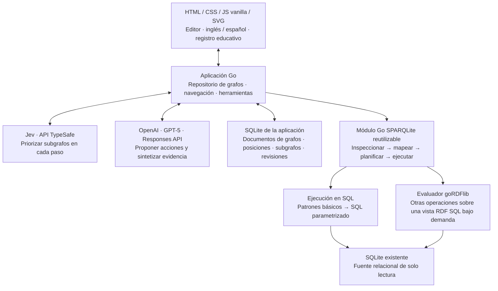

# SPINACH Lab + SPARQLite

[English — documento original](README.md) · [Diagrama de arquitectura](docs/architecture.svg) · [Informe de validación](docs/VALIDATION.md)

Dos proyectos conectados que también pueden usarse de forma independiente: un laboratorio visual para aprender cómo los grafos de conocimiento responden preguntas y un gateway en Go que permite consultar bases SQLite existentes mediante un mapeo RDF virtual y SPARQL.

**Estado: implementación experimental funcional. La conformidad completa con SPARQL 1.1 es un objetivo de publicación, no una característica que esta versión pueda afirmar.** La validación encontró nueve casos fallidos del W3C en el evaluador fijado como dependencia, y `SERVICE` no está soportado. Consultá [Capacidades y límites](#6-capacidades-y-límites) antes de integrar el motor.

## 1. Entender las dos partes

| Parte | Qué hace | ¿Funciona por separado? |
| --- | --- | --- |
| **SPINACH Lab** (`lab/`) | Un editor interactivo de grafos y una experiencia educativa de preguntas y respuestas paso a paso. | Sí. Los recorridos usan Jev y OpenAI; editar grafos y ejecutar SPARQL manual no necesita claves de API. |
| **SPARQLite** (`sparqlite/`) | Inspecciona un esquema SQLite existente, genera un vocabulario RDF virtual y responde SPARQL mediante compilación a SQL o un evaluador Go. También ofrece un modo separado de almacenamiento RDF nativo. | Sí, como biblioteca Go o servidor HTTP local. |

El frontend usa HTML, CSS, módulos JavaScript y SVG, sin framework ni proceso de compilación. El backend y el gateway usan Go y un controlador SQLite que no requiere CGO. El repositorio de grafos, el modelo de decisiones, el modelo de lenguaje y el registro de fuentes relacionales tienen interfaces separadas.

### Nuestra extensión: navegación guiada por Jev

El enfoque educativo está inspirado en [SPINACH, Liu y colaboradores](https://arxiv.org/abs/2407.11417), que explora una base de conocimiento, ejecuta SPARQL y usa las observaciones para continuar.

Nuestro experimento incorpora **Jev como capa de decisiones para la navegación**, mediante la API de TypeSafe. Prioriza los subgrafos al principio y nuevamente antes de cada acción del modelo. El subgrafo seleccionado se resalta y proporciona la región inicial del siguiente paso de exploración. **OpenAI GPT-5** propone acciones y consultas observables y sintetiza sus resultados.

Es una extensión experimental, no una mejora medida frente al sistema de investigación original. Las puntuaciones de Jev expresan preferencia entre opciones de navegación, no certeza factual sobre una respuesta.

## 2. Ejecutar el laboratorio

Instalá **Go 1.26 o posterior**. Ejecutá desde la raíz del repositorio; no hacen falta claves de API ni un archivo `.env` para iniciar:

```sh
go run ./lab/cmd/spinach -db ./lab/data/spinach.db
```

Abrí [http://127.0.0.1:8090](http://127.0.0.1:8090). Abrir `index.html` directamente no conecta la aplicación con su backend.

La interfaz se inicia en **inglés**. El botón **Español / English** del encabezado permite cambiar el idioma y el navegador recuerda la elección. El contenido importado, los identificadores de entidades y SPARQL siguen siendo datos de origen: cambiar el idioma de la interfaz no traduce la base de datos.

### Tu primer experimento

1. Abrí **Aurora Laboratory** y seleccioná la pregunta sobre física y París.
2. El operador del servidor configura Jev y OpenAI mediante variables de entorno o `.env` (ver más abajo). Los visitantes no ingresan claves ni eligen modelos.
3. Elegí **Paso a paso** o **Ejecutar todos los pasos**. Inspeccioná el modelo, contexto, tiempo, consulta y resultados reales de cada tarjeta.
4. Seleccioná una entidad para inspeccionar su identificador y sus conexiones.
5. Editá una relación, guardá y repetí la pregunta para observar si cambia el resultado.

Se incluyen cuatro universos ficticios: un pequeño laboratorio, una biblioteca, una red de misiones espaciales y una red de investigación más grande. Son ejemplos educativos, no conjuntos de datos factuales.

### Preguntas complejas para experimentar con la navegación

Abrí **Red de investigación**: 99 nodos, 295 relaciones y seis subgrafos superpuestos. Sus seis preguntas incluyen joins entre países, proyectos y financiadores; agregación de países distintos; exclusión de publicaciones retractadas; alianzas transitivas; suma de citas sin duplicados; y coautores de distintos países. Cada consulta SPARQL de referencia tiene resultados esperados verificados. La pregunta de citas devuelve **Project 05 con 100 citas**.

Elegí una pregunta, ejecutala con **Usar Jev** activado y repetí sobre el mismo grafo con el interruptor desactivado y la misma medición. El modelo recibe contexto acotado y observaciones de herramientas, **no las consultas de ejemplo resueltas**. Son casos ficticios para investigar cuándo ayuda navegar; su complejidad no garantiza una mejora de velocidad. La consulta de referencia sigue disponible en la consola SPARQL para inspeccionar el resultado esperado.

### Edición de grafos

- Arrastrá nodos para moverlos; desplazá el fondo y usá los controles de zoom.
- Hacé doble clic en un nodo para editarlo. **Nodo** agrega una entidad o un literal.
- **Conectar** permite elegir origen y destino y luego un predicado.
- Seleccioná nodos con Shift + clic y usá **Crear subgrafo** para agruparlos. Un subgrafo es una vista de navegación sobre entidades compartidas; no impide joins entre subgrafos.
- Deshacer/rehacer se aplica a las ediciones. **Guardar cambios** conserva el grafo y las posiciones en SQLite. Las consultas guardan las ediciones pendientes antes de evaluarse.
- Importá el JSON del laboratorio, N-Triples, Turtle o RDF/XML. La exportación JSON conserva posiciones, grupos, subgrafos y ejemplos.

El guardado utiliza revisiones optimistas. Si otra ventana cambió el grafo, se rechaza un guardado desactualizado en lugar de sobrescribirlo silenciosamente.

### IA mediante Jev y OpenAI

Toda inferencia usa APIs autenticadas. El backend Go conserva las credenciales; el navegador recibe nombres de modelos, estados de conexión de solo lectura y registros observables. Las claves nunca se envían al navegador ni se devuelven mediante una API.

| Función | API | Modelo predeterminado | URL base predeterminada |
| --- | --- | --- | --- |
| Navegación | TypeSafe System One | `jev-latest` | `https://api.typesafe.ai/v1` |
| Acciones, propuestas SPARQL y síntesis de respuestas | OpenAI Responses | `gpt-5` | `https://api.openai.com/v1` |

El backend llama a `/systemone` de Jev y `/responses` de OpenAI. El indicador de conexión comprueba el catálogo autenticado `/models` de cada servicio. Los proveedores y modelos están fijos para los visitantes; cada paso registra el identificador real devuelto por el servicio cuando está disponible.

**Solo el operador del servidor configura modelos y claves de API**, mediante variables de entorno del proceso y/o un archivo `.env` opcional. No hay selector de modelos, formulario de claves ni endpoint HTTP de configuración. Las solicitudes del recorrido no pueden reemplazar ninguno de los modelos. El interruptor **Usar Jev** solo activa o desactiva la navegación para comparar; no elige un modelo.

Copiá `.env.example` solo si todavía no existe `.env` y completá las claves en el servidor. El archivo se carga desde el directorio de trabajo; las variables de entorno del proceso tienen prioridad. Usá `-env /ruta/config.env` para otro archivo. **Reiniciá el servidor después de cambiar la configuración.** Mantené `.env` privado (por ejemplo, `chmod 600 .env`); está excluido de Git. Un despliegue puede inyectar las mismas variables desde su gestor de secretos sin usar un archivo. La aplicación ya no lee ni escribe `model-credentials.json`.

```dotenv
OPENAI_BASE_URL=https://api.openai.com/v1
OPENAI_MODEL=gpt-5
OPENAI_REASONING_EFFORT=medium
OPENAI_API_KEY=tu-clave-openai
JEV_BASE_URL=https://api.typesafe.ai/v1
JEV_MODEL=jev-latest
JEV_TOKEN=tu-token-jev
```

Para un experimento local de menor costo, configurá `OPENAI_MODEL=gpt-6-luna` con `OPENAI_REASONING_EFFORT=medium` y reiniciá. GPT-6 recibe el nivel de razonamiento explícitamente mediante Responses. Consultá la [evaluación de Luna](docs/VALIDATION.md#gpt-6-luna-local-evaluation): fue más rápido en la ejecución registrada, pero las comprobaciones semánticas y de idioma detectaron fallas, por lo que no está establecida su equivalencia con GPT-5.

En modo IA, la pregunta y el contexto relevante del grafo se envían a esas APIs. La interfaz lo informa antes del recorrido. Los proveedores pueden facturar el uso. La consola SPARQL manual ejecuta consultas sin inferencia de modelos. Si falta una clave necesaria, el modo IA informa que la conexión del servidor no está disponible; nunca sustituye automáticamente el servicio.

Escribí una pregunta. El recorrido siempre usa OpenAI, con navegación de Jev activada por defecto. Cada clic en **Siguiente paso** solicita una acción: buscar, explorar, consultar o responder. Con **Usar Jev** activado, Jev prioriza las regiones antes de cada acción. El backend ejecuta las herramientas, reconstruye las observaciones anteriores con los datos actuales y exige una consulta exitosa antes de aceptar una respuesta. Esto establece que existe evidencia consultada; no prueba que cada oración generada se deduzca de ella.

OpenAI recibe definiciones estrictas de funciones y debe devolver exactamente una acción. Cada solicitud es una propuesta nueva que incluye observaciones reconstruidas por el servidor, con `store: false`; la app no continúa un estado de conversación guardado por el proveedor. La función `answer` solo se ofrece después de una consulta exitosa. GPT-5 usa esfuerzo de razonamiento `medium` por defecto. Los registros exponen entradas, instrucciones, acciones y observaciones de la aplicación, no el razonamiento privado del modelo.

Elegí **Paso a paso** para avanzar manualmente o **Ejecutar todos los pasos** para completar el recorrido en orden. Esta última opción también reanuda un recorrido pausado. **Pausar después de este paso** deja terminar la solicitud actual; **Detener recorrido** cancela la solicitud activa y conserva las tarjetas completadas. La ejecución automática se detiene ante una respuesta final, un error de solicitud o el límite de ocho acciones. Los errores de herramientas vuelven como observaciones para que GPT-5 pueda intentar corregirlos.

Cada tarjeta desplegable muestra el modelo o regla determinista responsable, la acción, el resultado y su tiempo de procesamiento. Las tarjetas de IA permiten inspeccionar el contexto real del grafo y las instrucciones enviadas a OpenAI, además de la entrada, opciones y puntuaciones de Jev cuando está activado. Las tarjetas de consulta enlazan su propia tabla de resultados, incluso después de otras acciones.

Dos interruptores se recuerdan en el navegador y quedan bloqueados hasta que termina o se detiene el recorrido:

- **Usar Jev** (activado por defecto): desactivalo para ejecutar OpenAI sin solicitudes de navegación. GPT-5 recibe una vista sin filtrar de hasta 50 conexiones y elige cómo explorar. Con Jev activado, la vista proviene del subgrafo elegido con el mismo límite de conexiones. Las herramientas acceden al grafo completo en ambos modos. Un grafo con menos de dos subgrafos usa una regla estructural sin llamar a Jev.
- **Medir tiempos** (activado por defecto): muestra el tiempo de procesamiento en vivo y la duración de cada paso, incluidos los errores. Suma trabajo activo del navegador e intervalos de solicitud, incluida la red. Excluye las pausas de lectura y el guardado de cambios pendientes. El servidor informa por separado navegación, generación, revalidación de evidencia y herramientas; estos tiempos excluyen la red entre navegador y servidor y no tienen por qué sumar el total del navegador. Al desactivar la medición, se ocultan los tiempos del recorrido y se omiten los metadatos de selección/paso. La consola SPARQL conserva la duración de consulta.

Para comparar, ejecutá la misma pregunta sobre un grafo sin cambios y con el mismo modelo OpenAI, cambiando únicamente **Usar Jev** y manteniendo la medición activa. Los registros quedan en la sesión actual de la página, no como historial de benchmarks. Se necesitan ejecuciones repetidas y comprobaciones de evidencia antes de sacar conclusiones sobre velocidad o calidad.

Los tiempos de espera, modelos no disponibles, fallos de autenticación y respuestas inválidas producen errores explícitos. No hay sustitución automática por otro servicio de inferencia. Consultá la [evidencia de validación](docs/VALIDATION.md) para ver las pruebas reales de APIs y los límites pendientes.

## 3. Explorar una base SQLite existente

En el laboratorio, elegí **Explorar SQLite**, seleccioná un archivo y asignale un nombre. La aplicación conserva una copia local en `lab/data/sources/`, la abre en modo de solo lectura, inspecciona su estructura y dibuja una vista de hasta 80 triples. Las consultas acceden a **toda la base cargada**, no solamente a esa vista. El archivo original no se modifica ni queda sincronizado en vivo.

Para quitar una base importada, seleccioná su universo y hacé clic en **Eliminar SQLite** debajo del grafo. Al confirmar se eliminan el universo y sus subgrafos guardados, se cierra la conexión y se borra la copia cargada en la app. El archivo original no cambia. Si varios universos comparten la copia, el archivo se conserva hasta eliminar el último. Cancelar deja todo como estaba.

Si la base usa WAL, generá una copia de respaldo consistente antes de cargarla: copiar solamente el archivo principal puede omitir cambios todavía no consolidados. El límite de carga es 16 MB. El gateway independiente abre un archivo local directamente y no tiene ese límite de carga de la aplicación.

Las vistas SQLite permiten editar posiciones y subgrafos. La aplicación impide editar su contenido como grafo porque una modificación RDF arbitraria no tiene una traducción inequívoca a tablas relacionales. En estas vistas, **Esquema SQLite** abre el esquema descubierto.

### Mapeo automático

El mapeador lee `sqlite_schema`, columnas, claves primarias, claves foráneas declaradas e índices. Los metadatos del esquema se guardan en caché y se invalidan mediante `schema_version`. Cada consulta usa una transacción de lectura para obtener una vista consistente.

Para este esquema:

```sql
CREATE TABLE customers(id INTEGER PRIMARY KEY, name TEXT, city TEXT);
CREATE TABLE orders(
  id INTEGER PRIMARY KEY,
  customer_id INTEGER REFERENCES customers(id),
  amount REAL
);
```

expone, por ejemplo:

```turtle
<https://sqlite.local/customers/id=1>
    a <https://sqlite.local/customers> ;
    <https://sqlite.local/customers#name> "Ana" .

<https://sqlite.local/orders/id=101>
    <https://sqlite.local/orders#ref-customer_id>
    <https://sqlite.local/customers/id=1> .
```

- Las tablas se convierten en clases RDF; las filas con clave primaria, en sujetos IRI; los valores no nulos, en literales tipados.
- Las claves foráneas declaradas generan relaciones. Las claves y referencias compuestas se inspeccionan conjuntamente.
- SQL `NULL` no genera un triple para el valor de columna. Las tablas sin clave primaria usan nodos anónimos basados en un rowid accesible o, cuando hace falta, numeración de filas local a la consulta.
- Enteros, flotantes, textos y blobs se mapean según su tipo de almacenamiento SQLite en ejecución; los blobs usan `xsd:hexBinary`.
- Los nombres se escapan de forma determinista. No se adivinan relaciones no declaradas. Las vistas sin identificadores estables tienen limitaciones de identidad explícitas.

El diseño se inspira en [Direct Mapping del W3C](https://www.w3.org/TR/rdb-direct-mapping/); no se presenta como una implementación certificada de ese estándar. Las reglas de nombres y los tipos dinámicos de SQLite forman parte del contrato de mapeo de este proyecto.

## 4. Usar SPARQLite por separado

### Crear un ejemplo descartable

```sh
go run ./sparqlite/cmd/make-example -out examples/business.sqlite
go run ./sparqlite/cmd/sparqlite -db examples/business.sqlite
```

El generador se niega a sobrescribir un archivo existente. Inspeccioná el vocabulario en [http://127.0.0.1:8091/schema](http://127.0.0.1:8091/schema).

### Consultar mediante HTTP

```sh
curl http://127.0.0.1:8091/sparql \
  -H 'Content-Type: application/sparql-query' \
  -H 'Accept: application/sparql-results+json' \
  --data-binary 'SELECT ?name ?amount WHERE {
    ?order <https://sqlite.local/orders#ref-customer_id> ?customer .
    ?customer <https://sqlite.local/customers#name> ?name .
    ?order <https://sqlite.local/orders#amount> ?amount .
  }'
```

El endpoint relacional admite consultas GET, POST de formulario y `application/sparql-query`. Los resultados SELECT/ASK pueden negociarse como JSON, XML, CSV o TSV; los resultados de grafo se devuelven en Turtle. `X-SPARQLite-Engine` identifica la ruta de ejecución y `Server-Timing` informa el tiempo de consulta. Usá `FROM` / `FROM NAMED` para los grafos de tablas mapeadas; los parámetros HTTP de selección de dataset se rechazan explícitamente por ahora.

### Integrar la biblioteca Go

```go
source, err := sparqlite.Open("business.sqlite", "https://sqlite.local/")
if err != nil { return err }
defer source.Close()

result, report, err := source.Query(ctx, query)
// result: bindings RDF tipados o un grafo de resultados
// report: ruta de ejecución, SQL, parámetros, plan y duración
```

Importá `github.com/arturoeanton/go-r2-SPINACH/sparqlite`. El `go.work` del repositorio conecta los módulos locales. Para otro proyecto local, usá un workspace Go o un `replace` que apunte al directorio `sparqlite`. No se presupone que exista una versión publicada del módulo.

### Modo de almacenamiento RDF nativo

Cuando quieras administrar datos RDF en lugar de mapear tablas existentes:

```sh
go run ./sparqlite/cmd/sparqlite -rdf-store examples/knowledge.sqlite -write
```

Esto crea un almacén RDF separado basado en SQLite y expone el endpoint SPARQL de la dependencia en `/sparql` y el manejador Graph Store en `/data`. Sin `-write`, las escrituras quedan deshabilitadas. El modo RDF nativo usa el endpoint y el almacén de goRDFlib; no utiliza nuestro compilador SQL relacional.

La dependencia fijada proporciona sintaxis y evaluación de Query y Update, sujetas a los límites que se describen a continuación. `LOAD` remoto está deshabilitado de forma predeterminada. Si falla o se cancela una operación posterior, una actualización puede dejar aplicadas operaciones anteriores; no se promete atomicidad para todo un pedido con múltiples operaciones. No uses este endpoint experimental como servicio público de producción.

## 5. Arquitectura y ejecución



La aplicación llama a SPARQLite dentro de su proceso. El ejecutable independiente expone el mismo gateway por HTTP para otros proyectos; el laboratorio no necesita ese segundo servidor.

### ¿Qué ocurre con una consulta?

1. Analizar la consulta SPARQL con el parser Go de la versión fijada.
2. Abrir una transacción de lectura e inspeccionar o reutilizar los metadatos del esquema.
3. Construir relaciones RDF virtuales sobre las tablas SQL originales, sin crear una copia RDF completa.
4. Para patrones básicos compatibles, compilar una sentencia SQL parametrizada. La identidad física de las filas permite convertir joins RDF apropiados en joins SQL por clave primaria. Devolver el SQL generado y el plan de SQLite.
5. Para otras operaciones compatibles, ejecutar el evaluador Go mediante búsquedas SQL de patrones de triples bajo demanda. El resultado identifica esta ruta como `sparql-evaluator`, sin afirmar que cada consulta se convirtió en una sola sentencia SQL.
6. Conservar los bindings RDF tipados y devolver el resultado. La cancelación y los límites de tiempo/trabajo provocan errores explícitos.

En los universos educativos, los grafos son pequeños: se guardan como documentos de la aplicación, se reconstruyen como grafo RDF para cada consulta y se evalúan mediante la misma biblioteca SPARQL. Esa ruta es distinta de consultar una base relacional existente.

## 6. Capacidades y límites

| Área | Comportamiento actual |
| --- | --- |
| Joins BGP, SELECT, DISTINCT, ASK, LIMIT/OFFSET | Compilación a SQL cuando corresponde; evaluador en los demás casos. |
| FILTER, OPTIONAL, UNION, agregación, orden, caminos, subconsultas, CONSTRUCT/DESCRIBE | Soporte del evaluador; casos representativos seleccionados probados. No implica conformidad completa. |
| Grafos nombrados de tablas | Generados como `https://sqlite.local/graph/<tabla-escapada>`. |
| SPARQL Update sobre tablas relacionales existentes | Rechazado. No hay mapeo inverso automático. |
| RDF nativo: Query/Update/Graph Store | Delegado a goRDFlib; separado del mapeo relacional. |
| `SERVICE` federado | No soportado por el evaluador Go fijado. |
| FROM/LOAD remotos y cobertura completa del protocolo | No se afirman; la fuente relacional admite solamente sus grafos mapeados. |
| Validación W3C de consultas/datasets/actualizaciones | 513 casos hoja aprobados y 9 fallidos contra la versión fijada de la suite. El subconjunto de Update ejecutado pasó; eso no establece conformidad completa de Update de extremo a extremo ni del protocolo. |
| Vista del laboratorio | 400 nodos / 2.000 relaciones / 24 subgrafos; muestra hasta 500 filas con indicador explícito de vista limitada. |
| Política de recursos del gateway | 20 segundos para consultas HTTP; presupuesto de 200.000 soluciones intermedias en el evaluador; límite de 100.000 filas en la ruta SQL. Son límites operativos, no truncamientos silenciosos presentados como éxito. |
| Ejecución | Esta edición exige loopback local. Publicarla requiere un proxy inverso HTTPS y control de acceso; no incluye cuentas ni aislamiento multiusuario. Las credenciales del entorno configuran un servidor compartido. |

Por lo tanto, el proyecto **todavía no cumple el objetivo solicitado de compatibilidad SPARQL al 100%**. Falta completar federación, los casos del estándar que fallan, una matriz completa del protocolo y un contrato defendible para escrituras relacionales. La interfaz, el mapeo automático, el gateway reutilizable y las mediciones pueden evaluarse por separado de ese criterio de publicación.

## 7. Probar y medir

```sh
CGO_ENABLED=0 go test ./lab/... ./sparqlite/...
go test ./sparqlite -run '^$' -bench BenchmarkMapping -benchmem
```

La suma de tiempos del navegador también puede verificarse con `node --test lab/tests/*.test.mjs` (runner opcional de Node.js; Node no es necesario para ejecutar la app).

Las pruebas cubren resultados reales, semántica de duplicados, coincidencia SQL/evaluador, valores tipados, nulos, joins por claves foráneas, identificadores SQL escapados, cancelación, respuestas del protocolo, fuentes de solo lectura, persistencia, rechazo de revisiones desactualizadas y el contrato de navegación de Jev en cada paso, el protocolo de funciones estrictas de OpenAI, las credenciales exclusivas del servidor, la configuración de entorno al iniciar, el rechazo de modelos elegidos desde el navegador, la ausencia de escrituras de configuración web y la carga segura de configuración.

En el Apple M4 de desarrollo, una ejecución de benchmark midió aproximadamente **0,52 ms** para una consulta selectiva sobre 10.003 filas de clientes y **0,108 ms** para el join del ejemplo. Ese join tiene solamente tres filas de pedidos; no es una medición sobre un grafo grande. Son microbenchmarks locales con caché caliente, no una promesa general de rendimiento o latencia de producción. Volvé a medir con tus datos. El [informe de validación](docs/VALIDATION.md) contiene la procedencia y los casos de conformidad fallidos.

## 8. Estructura del proyecto

```text
README.md                 Documentación original en inglés
README.es.md              Traducción al español de ese archivo
go.work                   Workspace local de ambos módulos Go
lab/
  cmd/spinach/            Servidor del laboratorio
  internal/domain/       Modelo de grafo y contrato del repositorio
  internal/storage/      Repositorio SQLite y registro de archivos fuente
  internal/models/       Adaptadores API de Jev y OpenAI
  internal/config/       Carga del archivo de entorno
  internal/sparql/        Conversión aplicación ↔ RDF y resultados
  internal/app/          Manejadores HTTP y frontend embebido
sparqlite/
  cmd/sparqlite/          Servidor HTTP independiente
  cmd/make-example/       Generador de ejemplo relacional descartable
  schema.go              Inspección y reglas de mapeo
  direct.go, query.go     Compilación SQL física y selección de evaluador
  virtual.go             Store RDF de solo lectura sobre tablas SQL
  http.go                Endpoint de consultas relacionales
docs/
  architecture.svg        Diagrama de arquitectura independiente
  VALIDATION.md           Evidencia reproducible y límites conocidos
```

## 9. Resolver problemas

- **La página abre pero no carga grafos:** usá la URL HTTP del servidor, no `file://`.
- **Falla una llamada de API:** revisá las credenciales del servidor, la red, la cuota de la cuenta y el identificador exacto de `OPENAI_MODEL` / `JEV_MODEL` en la configuración del servidor. Acceder al catálogo no garantiza que una inferencia funcione. Reiniciá después de cambiar `.env`.
- **Falta una relación:** comprobá que la clave foránea esté declarada. El mapeador no infiere significado de negocio por similitud de nombres.
- **Una base cargada parece desactualizada:** cargá un respaldo consistente que incluya los cambios de WAL. La copia cargada es una instantánea.
- **Una consulta es lenta:** inspeccioná el SQL y el plan; revisá los índices y la selectividad de la fuente. El gateway no modifica la fuente para crear índices.
- **Falla una característica estándar:** conservá la consulta y un ejemplo mínimo, identificá la ruta de ejecución y consultá los límites conocidos. No interpretes un error o un límite de visualización como una respuesta vacía exitosa.

## 10. Atribución y mantenimiento de la documentación

La investigación y el nombre SPINACH corresponden a sus autores originales. Este repositorio es un experimento educativo independiente. [Artículo original](https://arxiv.org/abs/2407.11417) · [Implementación original](https://github.com/stanford-oval/spinach).

El parser/evaluador SPARQL y el endpoint RDF nativo provienen de [goRDFlib](https://github.com/tggo/goRDFlib), fijado en `v0.9.3`; el mapeo de SQLite existente, el compilador SQL, la aplicación y la orquestación de modelos son trabajo de integración de este proyecto. El acceso a SQLite usa [modernc.org/sqlite](https://pkg.go.dev/modernc.org/sqlite). Las dependencias conservan sus propias licencias; consultá los [avisos de terceros](docs/THIRD_PARTY.md). El código del proyecto está cubierto por la [licencia MIT](LICENSE) del repositorio.
