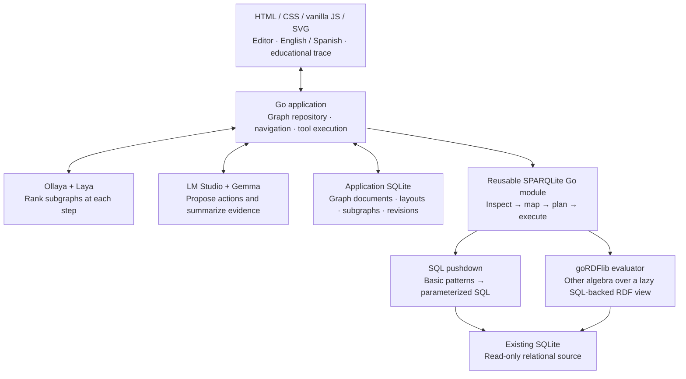

# SPINACH Lab + SPARQLite

[Español](README.es.md) · [Architecture diagram](docs/architecture.svg) · [Validation report](docs/VALIDATION.md)

Two connected, independently usable projects: a visual laboratory for learning how knowledge graphs answer questions, and a Go gateway that exposes existing SQLite databases through a virtual RDF mapping and SPARQL queries.

**Status: working experimental implementation. Full SPARQL 1.1 conformance is a release goal, not a claim about this version.** The validation run found nine failing W3C query/syntax cases in the pinned evaluator, and `SERVICE` is unsupported. See [Capabilities and limits](#capabilities-and-limits) before integrating the engine.

## 1. Understand the two parts

| Part | What it does | Can it run independently? |
| --- | --- | --- |
| **SPINACH Lab** (`lab/`) | An interactive graph editor and a step-by-step educational question-answering experience. | Yes. Guided practice needs no models. |
| **SPARQLite** (`sparqlite/`) | Inspects an existing SQLite schema, creates a virtual RDF vocabulary, and answers SPARQL through SQL compilation or a Go evaluator. Also provides a separate native RDF-store mode. | Yes, as a Go library or a local HTTP server. |

The frontend uses HTML, CSS, JavaScript modules and SVG, without a frontend framework or build step. The backend and gateway use Go and a SQLite driver that does not require CGO. The graph repository, decision model, language model and relational source registry have separate interfaces.

### Our extension: Laya-guided navigation

The educational approach is inspired by [SPINACH, Liu et al.](https://arxiv.org/abs/2407.11417), which explores a knowledge base, executes SPARQL and uses observations to continue.

Our experiment adds **Laya as a navigation decision layer**. Laya runs locally through Ollaya, ranks available subgraphs initially and again before each model action, and supplies the starting region for the next exploration step. Its selected subgraph is highlighted and its navigation choice is included in the action trace. Gemma proposes observable actions and queries and summarizes query results.

This is an experimental extension, not a measured improvement over the original research system. Laya scores express preference among navigation options, not factual confidence in the answer. Guided practice uses predefined selections and explicitly does not call Laya.

## 2. Run the laboratory

Install **Go 1.26 or newer**. Run these commands from the repository root:

```sh
go run ./lab/cmd/spinach -db ./lab/data/spinach.db
```

Open [http://127.0.0.1:8090](http://127.0.0.1:8090). Opening `index.html` directly will not connect the app to its backend.

The interface defaults to **English**. Use the **Español / English** button in the header to switch languages. The browser remembers the choice. Imported content, entity identifiers and SPARQL remain source data; changing the interface language does not translate the underlying database.

### Your first experiment

1. Open **Aurora Laboratory** and select the sample question about physics and Paris.
2. Keep **Guided practice · no AI**, then choose **Explore this question**.
3. Advance one step at a time. Inspect the SPARQL query and the real result table.
4. Select an entity to inspect its identifier and connections.
5. Edit a connection, save, and repeat the question to observe whether the result changes.

Three fictional universes are included: a research laboratory, a library and a space-mission network. They are teaching fixtures rather than factual datasets.

### Graph editing

- Drag nodes to move them; pan the background and use the zoom controls.
- Double-click a node to edit it. **Node** adds an entity or a literal.
- **Connect** asks you to choose a source and a target, then a predicate.
- Shift-click nodes and use **Create subgraph** to group them. A subgraph is a navigation view over shared entities; it does not prevent cross-subgraph query joins.
- Undo/redo applies to graph edits. **Save changes** persists the current graph and layout to SQLite. Queries save pending edits before evaluation.
- Import the lab's JSON format, N-Triples, Turtle or RDF/XML. JSON export preserves layout, groups, subgraphs and examples.

Saving uses optimistic revisions. If another window has changed the graph, a stale save is rejected instead of silently overwriting it.

### Local AI

The default generator is **LM Studio**, using its local API. Ollaya supplies Laya. The development machine exposed these model identifiers:

| Role | Server | Model | Default URL |
| --- | --- | --- | --- |
| Navigation | Ollaya | `laya:multilingual` | `http://127.0.0.1:11435` |
| Query/action generation and synthesis | LM Studio | `google/gemma-4-12b` | `http://127.0.0.1:1234` |

Start LM Studio's local server and load the desired model. In Ollaya, ensure the chosen model is installed and its server is running. The app discovers the installed model names in **Local models**; it does not download weights automatically.

```sh
ollaya serve
ollaya pull laya:multilingual
```

These are alternatives for starting/configuring Ollaya, not a command sequence to run inside an already blocking `serve` process. Use a second terminal for `pull` when needed.

Select **Local AI · Laya + Gemma** and enter a question. Every click on **Next step** requests one action: search, explore, query or answer. Laya ranks the navigation regions before each action. The backend executes tools, rebuilds earlier tool observations from the current data, and requires a successful query before accepting a final answer. This check establishes that query evidence exists; it does not prove every sentence in a generated answer is entailed by it.

The journey is limited to eight model actions. You can cancel it. Timeouts, missing models and malformed responses are shown as errors; guided practice remains available. A live journey was verified with the installed models: Laya selected Collaboration, Gemma ran a query, and its final answer correctly named Sofía Vega and Lina Costa as Elena’s collaborators. This completed in two model actions. Earlier probes timed out or attempted an answer before obtaining evidence; the action schema and backend now prevent that premature answer. One successful journey does not establish reliability or a latency improvement.

Configuration is through environment variables:

```sh
LMSTUDIO_URL=http://127.0.0.1:1234 \
OLLAYA_URL=http://127.0.0.1:11435 \
go run ./lab/cmd/spinach -db ./lab/data/spinach.db
```

An Ollama adapter is also available with `LLM_PROVIDER=ollama` and `OLLAMA_URL`. Select the actual Ollama identifier, such as `gemma4:12b`, in the model settings. LM Studio uses its own identifiers; the two names are not interchangeable.

## 3. Explore an existing SQLite database

In the lab, choose **Explore SQLite**, select a database file, and give it a name. The app saves a local copy in `lab/data/sources/`, opens it read-only, inspects its structure and draws a preview of up to 80 triples. Queries access the **entire uploaded database**, not just the preview. The original file is not changed or kept in live synchronization.

For a database using WAL, create a consistent SQLite backup before uploading; copying only the main file may omit uncheckpointed changes. Uploads are limited to 16 MB. The independent gateway opens a local file directly and has no application upload limit.

Mapped SQLite views permit layout and subgraph edits. The app prevents graph-content edits because an arbitrary RDF modification does not have an unambiguous translation back to relational tables. **Edit universe** opens the discovered schema for these views.

### Automatic mapping

The mapper reads `sqlite_schema`, columns, primary keys, declared foreign keys and indexes. Schema metadata is cached and invalidated using `schema_version`. Every query uses one read transaction for a consistent view.

For this schema:

```sql
CREATE TABLE customers(id INTEGER PRIMARY KEY, name TEXT, city TEXT);
CREATE TABLE orders(
  id INTEGER PRIMARY KEY,
  customer_id INTEGER REFERENCES customers(id),
  amount REAL
);
```

it exposes, for example:

```turtle
<https://sqlite.local/customers/id=1>
    a <https://sqlite.local/customers> ;
    <https://sqlite.local/customers#name> "Ana" .

<https://sqlite.local/orders/id=101>
    <https://sqlite.local/orders#ref-customer_id>
    <https://sqlite.local/customers/id=1> .
```

- Tables become RDF classes, primary-key rows become IRI subjects, and non-null column values become typed literals.
- Declared foreign keys become relationships. Composite keys and foreign keys are inspected together.
- SQL `NULL` does not create a column-value triple. Tables without a primary key use blank-node identities based on an accessible rowid, or query-local row numbering when necessary.
- Integer, floating-point, text and blob values are mapped using their runtime SQLite storage type; blobs use `xsd:hexBinary`.
- Names are escaped deterministically. Undeclared relationships are not guessed. Views without stable identifiers have explicit identity limitations.

This is inspired by [W3C Direct Mapping](https://www.w3.org/TR/rdb-direct-mapping/); it is not advertised as a certified implementation of that mapping standard. Naming rules and dynamic SQLite typing are part of this project's mapping contract.

## 4. Use SPARQLite independently

### Create a disposable example

```sh
go run ./sparqlite/cmd/make-example -out examples/business.sqlite
go run ./sparqlite/cmd/sparqlite -db examples/business.sqlite
```

The generator refuses to overwrite an existing file. Inspect the vocabulary at [http://127.0.0.1:8091/schema](http://127.0.0.1:8091/schema).

### Ask a question through HTTP

```sh
curl http://127.0.0.1:8091/sparql \
  -H 'Content-Type: application/sparql-query' \
  -H 'Accept: application/sparql-results+json' \
  --data-binary 'SELECT ?name ?amount WHERE {
    ?order <https://sqlite.local/orders#ref-customer_id> ?customer .
    ?customer <https://sqlite.local/customers#name> ?name .
    ?order <https://sqlite.local/orders#amount> ?amount .
  }'
```

The relational endpoint supports query requests through GET, form POST and `application/sparql-query`. SELECT/ASK results can be negotiated as JSON, XML, CSV or TSV; graph results are returned as Turtle. `X-SPARQLite-Engine` identifies the execution path and `Server-Timing` reports query time. Use `FROM` / `FROM NAMED` for mapped table graphs; HTTP dataset-selection parameters are currently rejected explicitly.

### Embed the Go library

```go
source, err := sparqlite.Open("business.sqlite", "https://sqlite.local/")
if err != nil { return err }
defer source.Close()

result, report, err := source.Query(ctx, query)
// result: typed RDF bindings or a result graph
// report: execution path, SQL, parameters, plan and duration
```

Import `github.com/arturoeanton/go-r2-SPINACH/sparqlite`. The repository's `go.work` links the local modules. For a separate local project, use a Go workspace or a `replace` pointing to this `sparqlite` directory. No published module release is assumed.

### Native RDF-store mode

When you want to own RDF data rather than map existing relational tables:

```sh
go run ./sparqlite/cmd/sparqlite -rdf-store examples/knowledge.sqlite -write
```

This creates a separate SQLite-backed RDF store and exposes the dependency's SPARQL endpoint at `/sparql` and Graph Store handler at `/data`. Without `-write`, writes are disabled. Native RDF mode uses goRDFlib's endpoint and store; it does not use our relational SQL compiler.

Query and Update syntax/evaluation are supplied by the pinned dependency, subject to the limitations below. Remote `LOAD` is disabled by default. Updates can leave earlier operations applied if a later operation fails or is canceled; an entire multi-operation request is not promised to be atomic. Do not use this experimental endpoint as a public production service.

## 5. Architecture and execution



The app calls SPARQLite in-process. The standalone binary exposes the same gateway over HTTP for other projects; the lab does not require that second server.

### What happens to a query?

1. Parse the SPARQL query with the pinned Go parser.
2. Open a read transaction and inspect or reuse the schema metadata.
3. Build virtual RDF relations from the original SQL tables. No complete RDF copy is created.
4. For eligible basic graph patterns, compile one parameterized SQL statement. Physical row identity allows suitable RDF joins to become primary-key SQL joins. Return the generated SQL and SQLite plan.
5. For other supported algebra, run the Go evaluator over lazy triple-pattern SQL lookups. The result identifies this path as `sparql-evaluator` rather than claiming every query compiled to one SQL statement.
6. Preserve typed RDF bindings and return the result. Cancellation and time/work limits fail explicitly.

In the visual teaching universes, graphs are small: they are stored as application documents, reconstructed as an RDF graph for a query, and evaluated through the same SPARQL library. That execution path is different from querying an existing relational database.

## 6. Capabilities and limits

| Area | Current behavior |
| --- | --- |
| BGP joins, SELECT, DISTINCT, ASK, LIMIT/OFFSET | SQL pushdown when eligible; evaluator otherwise. |
| FILTER, OPTIONAL, UNION, aggregation, ordering, paths, subqueries, CONSTRUCT/DESCRIBE | Evaluator support; selected representative cases tested. Not a full conformance guarantee. |
| Named table graphs | Generated as `https://sqlite.local/graph/<escaped-table>`. |
| SPARQL Update over existing relational tables | Rejected. Automatic inverse mapping is not implemented. |
| Native RDF Query/Update/Graph Store | Delegated to goRDFlib; separate from relational mapping. |
| Federated `SERVICE` | Unsupported by the pinned Go evaluator. |
| Remote FROM/LOAD and complete protocol coverage | Not claimed; the relational source accepts its own mapped graphs only. |
| W3C query/dataset/update validation | 513 leaf cases passed and 9 failed against the pinned W3C suite snapshot. The Update subset run passed; this does not establish complete end-to-end Update or Protocol conformance. |
| Lab display | 400 nodes / 2,000 edges / 24 subgraphs; result display capped at 500 rows with an explicit limited-view indicator. |
| Gateway resource policy | 20-second HTTP query timeout; evaluator budget of 200,000 intermediate solutions; pushdown result guard of 100,000 rows. These are operational limits, not silent successful truncation. |
| Deployment | Local loopback only. No accounts, multi-user isolation or hosted deployment. |

The project therefore does **not yet meet the requested 100% SPARQL compatibility goal**. Remaining work includes federation, the failing standard cases, a complete protocol matrix and a defensible contract for relational writes. The UI, automatic mapping, reusable gateway and performance probes can be evaluated independently of that release gate.

## 7. Test and measure

```sh
CGO_ENABLED=0 go test ./lab/... ./sparqlite/...
go test ./sparqlite -run '^$' -bench BenchmarkMapping -benchmem
```

Tests cover real query results, duplicate semantics, SQL/evaluator agreement, typed values, null handling, foreign-key joins, escaped SQL identifiers, cancellation, protocol responses, source read-only behavior, persistence, stale-revision rejection and Laya's per-step navigation contract.

On the development Apple M4, a single benchmark run measured approximately **0.52 ms** for a selective query over 10,003 customer rows and **0.108 ms** for the example join. That join has only three order rows; it is not a large-graph benchmark. These are warm local microbenchmarks, not a general throughput or production-latency promise. Re-run them on your data. See [the validation report](docs/VALIDATION.md) for provenance and the failed conformance cases.

## 8. Project layout

```text
README.md                 English documentation: source of truth
README.es.md              Spanish translation of this file
go.work                   Local workspace linking both Go modules
lab/
  cmd/spinach/            Laboratory server
  internal/domain/       Graph model and repository contract
  internal/storage/      SQLite repository and source-file registry
  internal/models/       Ollaya, LM Studio and Ollama adapters
  internal/sparql/        App ↔ RDF conversion and query results
  internal/app/          HTTP handlers and embedded frontend
sparqlite/
  cmd/sparqlite/          Independent HTTP server
  cmd/make-example/       Disposable relational example generator
  schema.go              Introspection and mapping rules
  direct.go, query.go     Physical SQL compilation and evaluator routing
  virtual.go             Lazy read-only RDF Store over SQL tables
  http.go                Relational query endpoint
docs/
  architecture.svg        Standalone architecture diagram
  VALIDATION.md           Reproducible evidence and known gaps
```

## 9. Troubleshooting

- **The page opens but does not load graphs:** use the HTTP server URL, not `file://`.
- **A model is listed but generation fails:** check that it is loaded, fits in memory and accepts structured outputs. LM Studio's identifier must match exactly. Generation may time out even when model discovery succeeds.
- **A relationship is missing:** inspect whether a foreign key is actually declared. The mapper does not infer business meaning from similar column names.
- **An uploaded database seems stale:** upload a consistent backup that includes changes committed through WAL. The uploaded copy is a snapshot.
- **A query is slow:** inspect the generated SQL and plan; check source indexes and selectivity. The gateway does not modify the source to create indexes.
- **A standard feature fails:** retain the query and a small reproducer, check the execution path, and consult the known gaps. Do not interpret failure or a preview limit as an empty successful answer.

## 10. Attribution and documentation maintenance

SPINACH's research and name belong to their original authors. This repository is an independent educational experiment. [Original paper](https://arxiv.org/abs/2407.11417) · [Original implementation](https://github.com/stanford-oval/spinach).

The SPARQL parser/evaluator and native RDF endpoint come from [goRDFlib](https://github.com/tggo/goRDFlib), pinned to `v0.9.3`; the existing-SQLite mapping, SQL compiler, application and model orchestration are this project's integration work. SQLite access uses [modernc.org/sqlite](https://pkg.go.dev/modernc.org/sqlite). Dependencies retain their own licenses; see [third-party notices](docs/THIRD_PARTY.md). Project code is covered by the repository's [MIT license](LICENSE).

Update this English README first, then translate the same sections, commands, limitations and measurements into `README.es.md`. The Spanish document must not introduce stronger claims than the English source.
